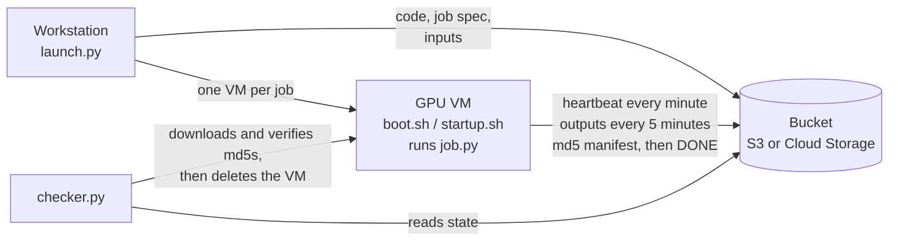

# Handwriting Recognition GPU Pipeline

A GPU training pipeline on AWS EC2 and Google Compute Engine for fine-tuning vision-language
models (Qwen3-VL with LoRA, and TrOCR) to transcribe 17th-century handwritten archival records.
Built for the [Zindi R.O.A.D. Barbados Historic Handwriting Challenge](https://zindi.africa),
where it finished with a private leaderboard score of 0.9157.

> **No competition data is included.** The dataset was provided only for taking part in the
> challenge and may not be redistributed, so nothing under `data/` is ever committed (see
> `.gitignore`). Every test that needs it skips itself when it is absent. To run the models,
> register for the challenge on Zindi and place its files under `data/`.

## What is in here

| Part | Where | What it does |
|---|---|---|
| Cloud pipeline | `cloud/aws/`, `cloud/gcp/` | Launches one GPU VM per job, runs it unattended, and brings the results home, on either cloud |
| Recognisers | `src/road/trocr.py`, `src/road/qwenvl.py` | Fine-tune `microsoft/trocr-base-handwritten`, and LoRA fine-tune Qwen3-VL 4B and 8B |
| Evaluation | `src/road/metric.py`, `src/road/cv.py` | The competition metric (0.5 x WER + 0.5 x CER), cross-checked against `jiwer`, and a held-out fold |
| Ensembling | `src/road/ensemble.py`, `scripts/combine_judges.py` | Pools candidate transcriptions from every model and lets several models score them |
| Augmentation | `src/road/stackmix.py` | Synthesises extra training lines from word crops (StackMix) |
| Notebooks | `notebooks/` | The Colab front end for the same code, with outputs stripped |

## Cloud pipeline

Training moved from Colab to the cloud when Colab's compute ran out, first to a single L4 on
Google Compute Engine and then to three single-GPU instances on AWS. Three rules shaped it:

1. **A VM can vanish at any moment and nothing is lost.** State lives in the bucket, not on the VM.
2. **No VM is deleted until its results are home and verified.**
3. **An ended job never sits billing.** GPU time is the main cost, so every VM shuts itself down.



| Component | Role |
|---|---|
| `launch.py` | Stages only what each job reads, then creates one VM per job. Refuses to launch a job while any input it waits for is still missing from the bucket. Falls back through GPU types and zones when capacity runs out (on AWS: `g6e.xlarge` L40S, `g6e.2xlarge`, `g5.xlarge` A10G, `g6.xlarge` L4). |
| `boot.sh` (AWS), `startup.sh` (GCP) | Runs on every boot and is idempotent: a job already DONE or FAILED is never rerun. Installs a pinned toolchain (`uv` checked against its sha256, Python 3.13, torch for CUDA 12.8). On AWS it installs the job as a systemd service, so it survives reboots. Any failure before the job starts still writes FAILED to the bucket. |
| `job.py` | Runs the job's steps with its state in the bucket: a heartbeat every minute (step, epoch, batch, last log line), outputs synced every 5 minutes, an md5 manifest of every output, and DONE only after the final sync succeeds. |
| `checker.py` | Shows each job's progress, ETA and heartbeat age, flags a heartbeat older than 15 minutes, and restarts a VM that stopped early (at most twice). When a job ends it downloads the outputs, checks every file against the bucket's md5s and the VM's manifest, and only then deletes the VM. `--chain` launches the next job once the previous one succeeded, which is how one GPU of quota ran two models back to back. |

### Cost and safety controls

**AWS**
- Each instance terminates itself 2 minutes after its job ends, once the job's DONE or FAILED
  is in the bucket. If neither is there, it stops instead and keeps its disk, so results are
  never lost.
- Its IAM role reaches only the project bucket. Its one EC2 permission, `ec2:TerminateInstances`,
  is limited by a condition to instances tagged `purpose=road-htr`.
- Every boot schedules a power-off `MAX_HOURS` ahead as a hard cap, and instances are launched
  to stop, not terminate, on that power-off.
- IMDSv2 is required, and the 200 GB gp3 root disk is deleted with the instance.

**Google Cloud**
- Each VM powers off 2 minutes after its job ends, unless the checker has already deleted it.
- `--max-run-duration` stops a VM whatever it is doing. GPU VMs terminate on host maintenance
  and restart on failure.
- VM access scopes are limited to Cloud Storage and logging.

**Both**
- Every wait on another job is capped at 30 minutes, because an idle VM still bills.
- A CPU rehearsal at smoke size (about USD 0.05 on AWS) runs the whole pipeline before any
  GPU is rented.
- A restarted checker never launches or deletes anything twice.

## Results and what they showed

- **Final private score: 0.9157** (the leaderboard's normalised metric, higher is better), from
  ensembles in which several fine-tuned TrOCR and Qwen3-VL models score a shared pool of
  candidate lines.
- **Seed noise beat recipe changes.** The same recipe with another seed moved the public score
  by about 0.005, more than any single recipe change. Paired comparisons on the held-out fold
  were the more reliable guide.
- **More, and more varied, judges won.** On the held-out fold, scoring candidates with all
  eight models beat the two-model ensemble by 0.0116 (5.1 standard deviations under paired
  bootstrap), with TrOCR in every top subset.
- **Throughput.** An L40S trained the 4B model at about 24 minutes an epoch, about 1.3 times
  slower than Colab's A100, probably because a `g6e.xlarge` has only 4 vCPUs to feed the GPU.
  An A10G took about 52 minutes for the same work.

## Repository layout

```
cloud/aws/      launch.py (setup, stage, rehearse, create), boot.sh (EC2 user data)
cloud/gcp/      launch.py, startup.sh, job.py (the job runner both clouds use), checker.py
src/road/       recognisers, metric, cross-validation, ensembling, StackMix, data paths
scripts/        analysis and ensembling tools (judge matrix, oracle, rescoring, figures)
notebooks/      Colab notebooks: setup, TrOCR, Qwen3-VL, ensemble (outputs stripped)
tests/          pytest suite, including the cloud launchers' generated commands and policies
```

## Quick start

Requirements: Python 3.12 or newer for the local tools, the `aws` CLI or `gcloud` for the cloud
pipeline, and a GPU (Colab or the cloud pipeline) for training.

```bash
python -m venv .venv && . .venv/bin/activate      # Windows: .venv\Scripts\activate
pip install -r requirements-local.txt
pytest                                            # unit tests; data-dependent tests skip themselves
```

Configure the cloud pipeline through environment variables; the defaults are placeholders.

| Variable | Used by | Meaning |
|---|---|---|
| `ROAD_AWS_ACCOUNT` | `cloud/aws/launch.py` | Your 12-digit AWS account ID (the bucket is `road-htr-<account>`) |
| `ROAD_AWS_REGION` | `cloud/aws/launch.py` | AWS region, default `us-east-1` |
| `ROAD_GCP_PROJECT` | `cloud/gcp/launch.py`, `checker.py` | Your GCP project (the bucket is `<project>-road-htr`) |
| `ROAD_RUNS` | checker and scripts | Local folder where finished runs are copied, default `runs` |

```bash
python3 cloud/aws/launch.py setup        # private bucket and an IAM role limited to it
python3 cloud/aws/launch.py stage        # code, inputs and job specs to S3
python3 cloud/aws/launch.py rehearse     # one CPU instance at smoke size
python3 cloud/aws/launch.py create       # the GPU jobs
python3 cloud/aws/launch.py --dry-run create   # print every aws command and run none
python3 cloud/gcp/checker.py --cloud aws # watch, verify, bring results home
```

## Testing

`pytest` runs 110 tests: on a machine without the dataset, 100 pass and 10 skip because they need
it. The cloud tests check the generated commands and policies without touching an account, for
example that the IAM policy limits termination to tagged instances and that every wait is capped.
Tests marked `slow` load the real 1.3 GB TrOCR checkpoint (`pytest -m slow`).

Every commit and push is scanned for secrets by gitleaks through `.pre-commit-config.yaml`
(`pre-commit install --hook-type pre-commit --hook-type pre-push`).

## License

Released under the [MIT License](LICENSE). The competition data is not included and is not
covered by this license; see the challenge's own terms on Zindi.
